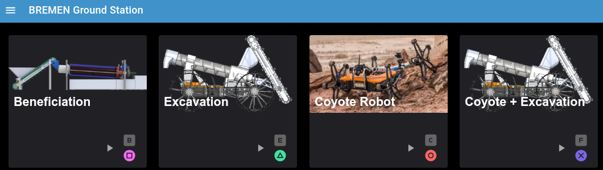
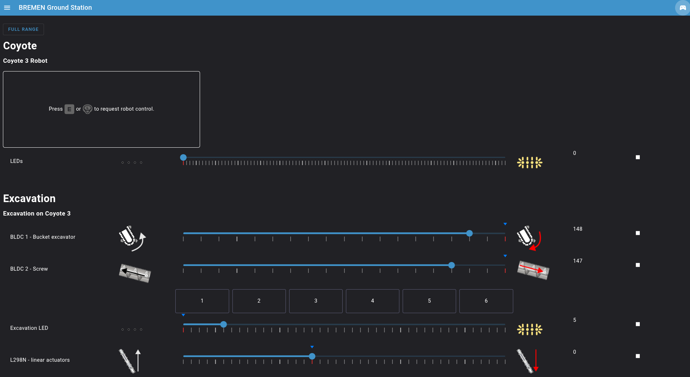
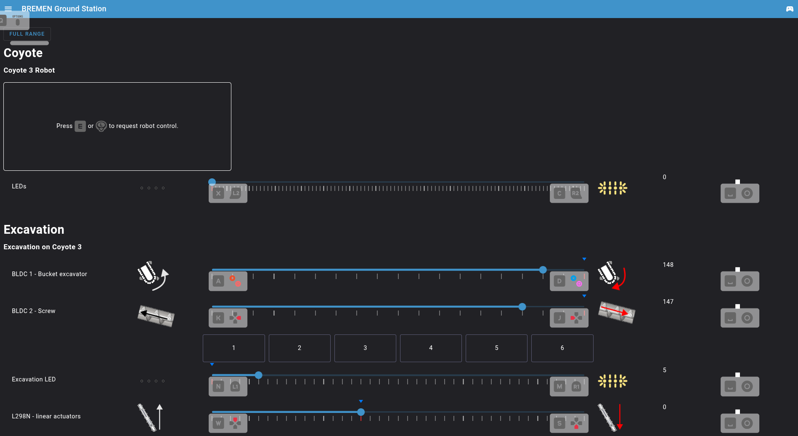
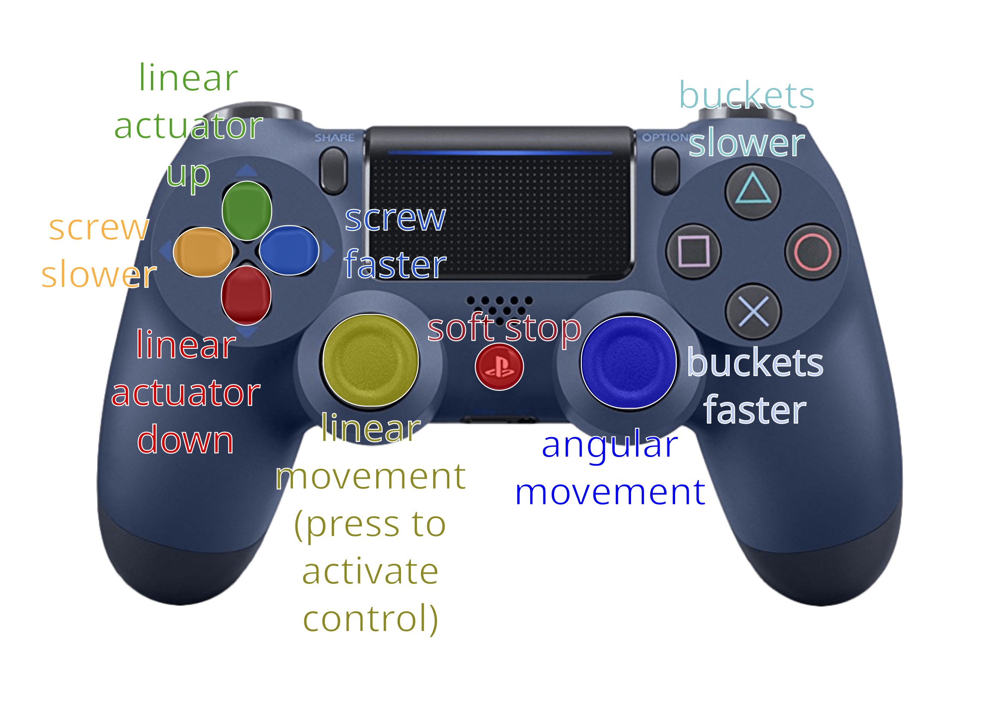

### Screenshots
After going to the UI in the browser you see this screen: 

(Maybe without the beneficiation system, we disabled it after the challenge as the robot is presented without it most of the time)

Click on the small arrow next to "Coyote + Excavation", press the F-button on the keyboard or press the cross-button on the gamepad to go to the next screen to control the coyote excavation systems:

Here you can control both systems; you can just use a mouse or touch screen to control it.

The small blue arrows on the scroll-bar show the current value of the system.

IMPORTANT: You can always press the space bar or the round home-button in the middle of the controller for a soft-stop for the excavation system. When you press it the bucket, screw and linear actuators should stop immediately. However, this is only a soft stop, so all systems will stay on and have power. 

In case of an emergency press the emergency-off button on the remote emergency-off!

In case you don’t know the buttons, you can simply press H on the keyboard or Share-button on the controller and an overlay will appear showing you the actual commands:

The system only allows you to set certain values, so you can for example not run the screw or buckets backwards and cannot go with the light to full brightness. But when you press the “FULL RANGE”-button, you can overwrite this safety and set any value that is available by the system.

### Gamepad controller
The shoulder-buttons L1 and R1 control the back light (right=brighter, left=darker), L2 and R2 control the front light, the other buttons are configured like this:
